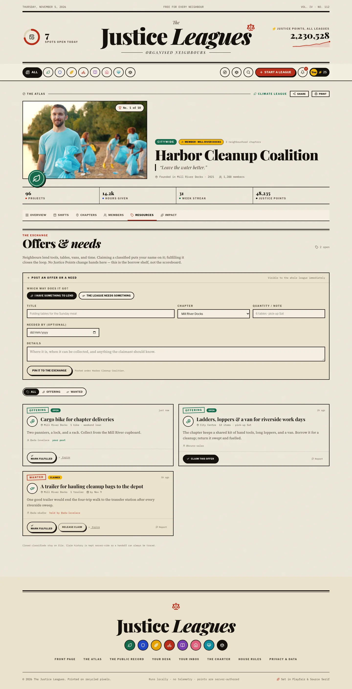
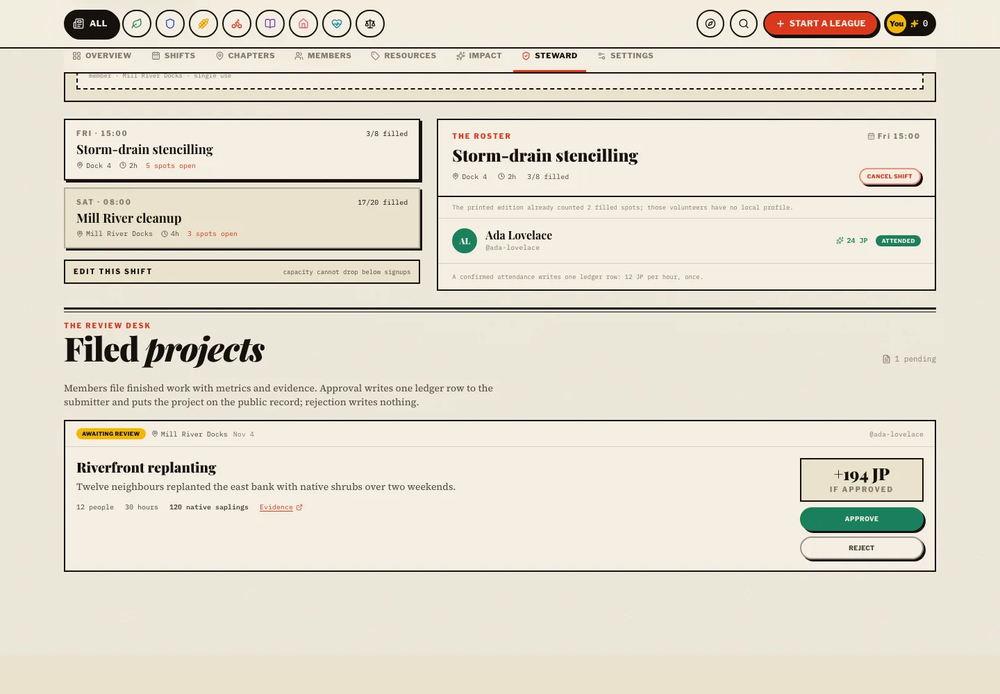
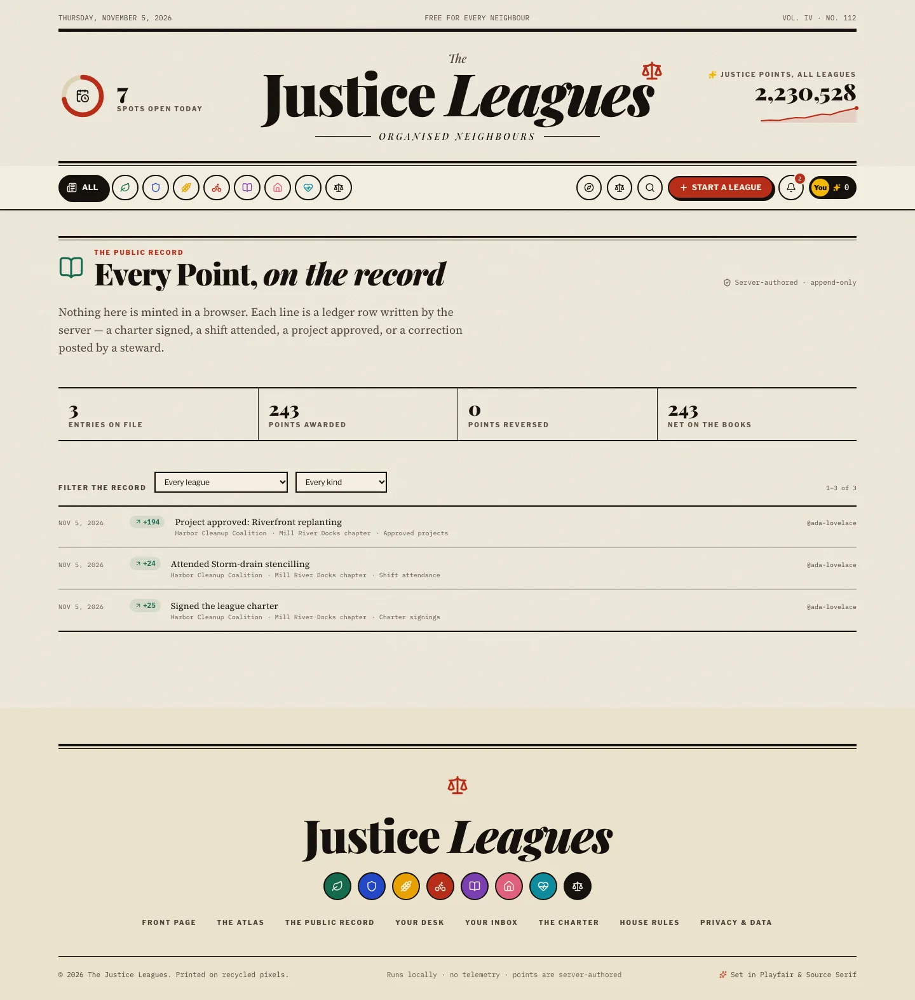
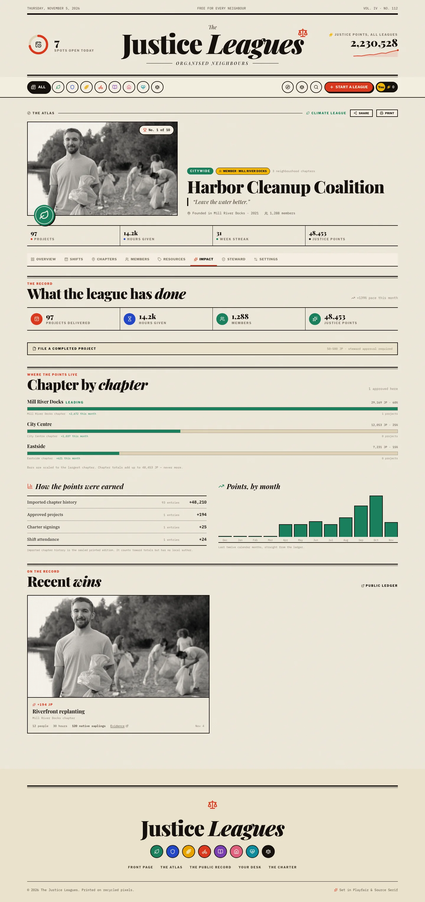
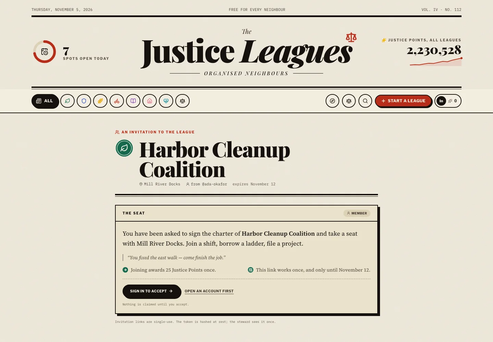
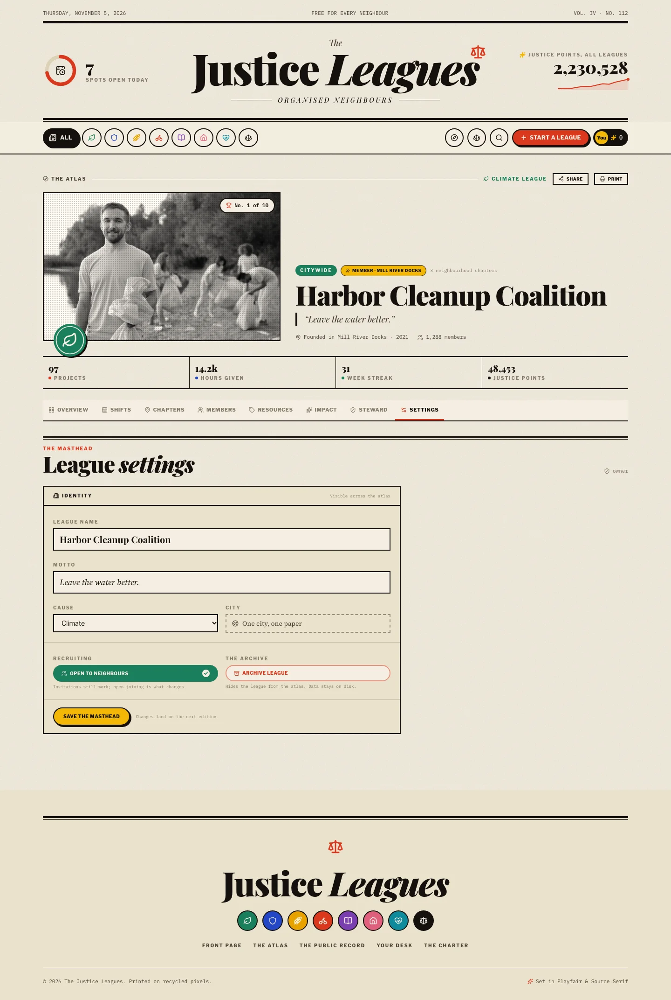
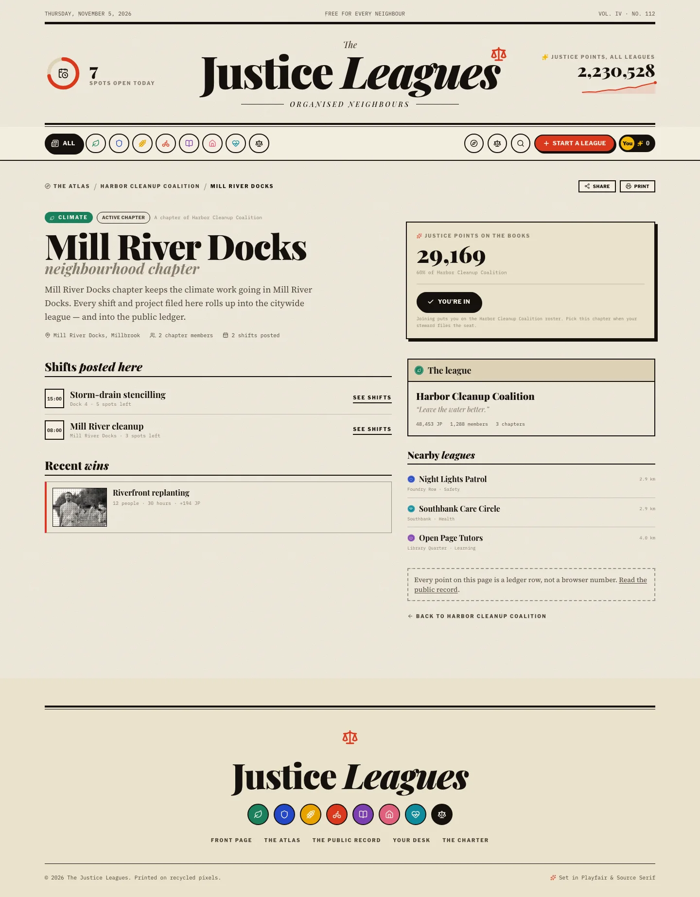
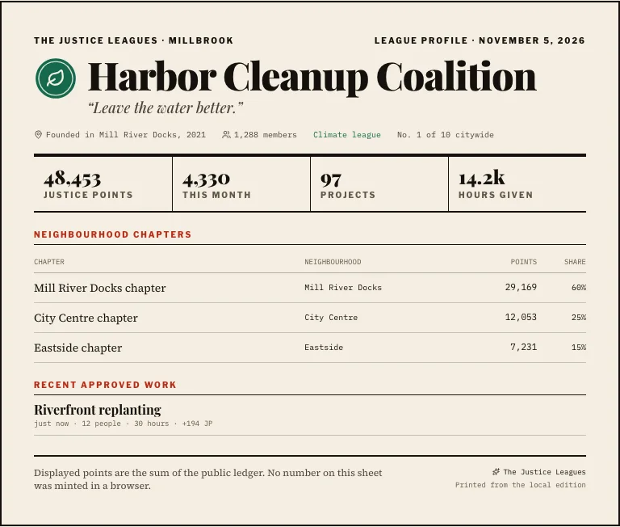

<div align="center">
  
</div>

<div align="center">
  <a href="https://github.com/Abhinav-Prabhakar/JusticeLeagues/stargazers"></a>
  <a href="https://github.com/Abhinav-Prabhakar/JusticeLeagues/commits/main"></a>
  <a href="LICENSE"></a>
  
  
  
  
  
  <a href="https://abhinav-prabhakar.github.io/JusticeLeagues/"></a>
</div>

<h3 align="center">A local-first civic newspaper for citywide leagues, neighbourhood chapters,<br/>volunteer shifts, and Justice Points.</h3>

<p align="center">
  <a href="#run-it"><strong>Run it</strong></a> ·
  <a href="https://abhinav-prabhakar.github.io/JusticeLeagues/"><strong>Read the static edition</strong></a> ·
  <a href="#the-paper-in-pictures"><strong>Screens</strong></a> ·
  <a href="#under-the-hood"><strong>Architecture</strong></a> ·
  <a href="ROADMAP.md"><strong>Roadmap</strong></a>
</p>


## What it is

- **Citywide leagues, neighbourhood chapters.** Climate, safety, food, transit, learning, housing, health, rights.
- **An atlas you can search.** Name, neighbourhood, cause, or motto. SQLite FTS5 ranks by relevance, then the atlas re-ranks by walking distance. `q`, `cause`, `near`, and `radius` live in the URL, and “near me” falls back to a neighbourhood picker.
- **A chapter with its own front door.** Every chapter has a shareable page with its shifts, wins, nearby leagues, and a copy/native share button.
- **A printed profile.** Any league prints as a clean sheet — chapters table, recent approved work, and the ledger line, with the site chrome stripped by print CSS.
- **Real shifts, real capacity.** Join a league, claim a shift, survive a refresh. Two accounts see the same filled spots.
- **A full shift queues, not closes.** Waitlists promote the first neighbour when a spot opens; stewards can edit capacity, date, or place without losing signups.
- **A steward desk, not a form.** Stewards post shifts, cancel them, record attendance, and approve the projects that earn points.
- **A masthead the owner keeps.** Stewards edit the name, motto, cause, and recruiting flag; only the owner can archive the league.
- **A borrow shelf, not a scoreboard.** Neighbours post offers and needs, claim them, hand them back, and close the loop — with no Justice Points attached.
- **A front door a steward controls.** Mint a single-use invitation link for a member or a steward, filed under a chapter.
- **Leaderboards the server ranks.** Global, month, cause, city, and chapter standings come from a cached table rebuilt on every ledger write — never a client sort.
- **Badges and weeks on.** Thirteen badges and a streak are earned from the record, not handed out. Your desk shows what you have and what is next.
- **A public record.** Every award lands on [`/ledger`](src/routes/LedgerPage.tsx) with its author, kind, and delta. A steward correction appends a negative row; it never rewrites history.
- **A review desk, not a rubber stamp.** Soft caps and evidence-free projects queue for a steward, who can clear or reverse with an auditable note.
- **A real impact page.** Chapter, category, and month totals are aggregated from the ledger, and the chapter bars always sum to the league total.
- **Server-authored Justice Points.** Append-only ledger. Joining awards +25 once; signup mints nothing; check-in awards hours × 12 (capped at 80); an approved project awards `50 + 4×hours + 2×people`, clamped 50–500.

> Points land when a steward checks you in — not when you tap sign up. That distinction is the whole leaderboard.

## The paper in pictures

<table>
  <tr>
    <td width="50%"><a href="docs/screenshots/league.webp"></a><br/><sub><b>League page</b> · tabs, standing, and the next shift</sub></td>
    <td width="50%"><a href="docs/screenshots/steward.webp"></a><br/><sub><b>Steward desk</b> · post a shift, record hours, approve the project</sub></td>
  </tr>
  <tr>
    <td width="50%"><a href="docs/screenshots/chapters.webp"></a><br/><sub><b>Chapters</b> · every point rolls up to the citywide league</sub></td>
    <td width="50%"><a href="docs/screenshots/dashboard.webp"></a><br/><sub><b>Your desk</b> · points, roster, badges, and the ledger</sub></td>
  </tr>
  <tr>
    <td width="50%"><a href="docs/screenshots/resources.webp"></a><br/><sub><b>The exchange</b> · offers and needs, claimed and closed</sub></td>
    <td width="50%"><a href="docs/screenshots/projects.webp"></a><br/><sub><b>The review desk</b> · members file the work, stewards approve the points</sub></td>
  </tr>
  <tr>
    <td width="50%"><a href="docs/screenshots/ledger.webp"></a><br/><sub><b>The public record</b> · every award, its author, and its delta</sub></td>
    <td width="50%"><a href="docs/screenshots/impact.webp"></a><br/><sub><b>Impact</b> · chapters, categories, and months from the ledger</sub></td>
  </tr>
  <tr>
    <td width="50%"><a href="docs/screenshots/invite.webp"></a><br/><sub><b>The invitation</b> · a single-use link, filed under a chapter</sub></td>
    <td width="50%"><a href="docs/screenshots/settings.webp"></a><br/><sub><b>The masthead</b> · stewards edit, the owner archives</sub></td>
  </tr>
  <tr>
    <td colspan="2"><a href="docs/screenshots/leagues.webp"></a><br/><sub><b>The Atlas</b> · search, causes, and a walkable radius</sub></td>
  </tr>
  <tr>
    <td width="50%"><a href="docs/screenshots/chapter.webp"></a><br/><sub><b>A chapter</b> · its own shareable front door</sub></td>
    <td width="50%"><a href="docs/screenshots/print.webp"></a><br/><sub><b>The printed profile</b> · chapters, work, and the ledger line</sub></td>
  </tr>
</table>

<table>
  <tr>
    <td width="33%"><a href="docs/screenshots/mobile-home.webp"></a></td>
    <td width="33%"><a href="docs/screenshots/mobile-league.webp"></a></td>
    <td width="33%"><a href="docs/screenshots/mobile-dashboard.webp"></a></td>
  </tr>
  <tr>
    <td align="center"><sub>Front page</sub></td>
    <td align="center"><sub>League</sub></td>
    <td align="center"><sub>Your desk</sub></td>
  </tr>
</table>

## Under the hood


| Layer  | Choice                                                            |
| ------ | ----------------------------------------------------------------- |
| UI     | React 19 · Vite · Tailwind 4 · TanStack Query                     |
| API    | Hono on Node · Zod · scrypt · hashed session cookies              |
| Data   | `node:sqlite` · plain-SQL migrations · append-only points ledger  |
| Ranks  | `league_standings` / `chapter_standings` caches, rebuilt on write |
| Search | `league_search` FTS5 cache + haversine distance in the API        |
| Assets | Photography and fonts vendored into `public/` — fully offline     |

Points flow one way: an action hits a Hono route, the repository validates it,
the ledger appends a row, and the standings cache is rebuilt inside the same
transaction. The browser can read standings and the ledger; it cannot send a
delta.

## Run it

```bash
npm install
npm run dev        # web :5173 · api :8787
```

Production-ish, one origin:

```bash
npm run build
npm start          # dist/ + /api on :8787
```

### Static edition

The GitHub Pages build is the same paper with the press stopped: browse every league, chapter, roster, shift, standings table, and the public record. Atlas search runs against the printed fixtures with the same cause and distance rules, so discovery works with no API. Accounts and new points live only in the local database, so standings and the ledger fall back to the printed edition.

```bash
npm run build:pages   # /JusticeLeagues/ base, hash routes, fixtures only
```

It ships to <https://abhinav-prabhakar.github.io/JusticeLeagues/> from the `gh-pages` branch — no deployment workflow, no Actions checks:

```bash
npm run publish:pages   # build, then force-push dist/ to gh-pages
```

Sign-in, joining, and the steward desk are intentionally read-only there — run the app locally for the full edition.

Local data lives in `data/justice-leagues.db`.

```bash
npm run db:seed    # migrate + seed if empty
npm run db:reset   # throw the paper away and rebuild it
```

### Demo stewards

A fresh seed gives every chapter a steward. The founding chapter's steward owns the league. They all use the password `millbrook`:

```text
steward.harbor.1@justiceleagues.local   # owner, Mill River Docks
steward.harbor.2@justiceleagues.local   # steward, City Centre
steward.harbor.3@justiceleagues.local   # steward, Eastside
```

Swap `harbor` for any league id (`spoke`, `ridgeline`, `civic`, …) and `1`–`3` for a chapter. These are local demo accounts — nothing leaves the machine.

## Checks

```bash
npm run typecheck
npm run lint
npm run test       # 98 unit + API integration tests
npm run test:e2e   # 24 Playwright tests, isolated :8788 / :5174 / data/e2e.db
npm run shots      # design-review screenshots → /tmp/jl-shots
```

## House rules

- **No hosted services.** No Supabase, no cloud sync, no telemetry.
- **Points are data, not decoration.** Every award is a ledger row with an idempotency key.
- **Editorial first.** Read [`DESIGN.md`](DESIGN.md) before touching the UI.
- **Commit small, push often.** See [`AGENTS.md`](AGENTS.md).

<div align="center">
  <sub>Photography from <a href="https://www.pexels.com/license/">Pexels</a> · typefaces via <a href="https://fonts.google.com/">Google Fonts</a> (OFL) · built with too much coffee.</sub>
</div>
