<div align="center">
  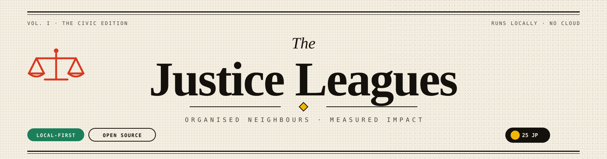
</div>

<div align="center">
  <a href="https://github.com/Abhinav-Prabhakar/justice-leagues/stargazers"></a>
  <a href="https://github.com/Abhinav-Prabhakar/justice-leagues/commits/main"></a>
  <a href="LICENSE"></a>
  
  
  
  
  
</div>

<h3 align="center">A local-first civic newspaper for citywide leagues, neighbourhood chapters,<br/>volunteer shifts, and Justice Points.</h3>

<p align="center">
  <a href="#run-it"><strong>Run it</strong></a> ·
  <a href="#the-paper-in-pictures"><strong>Screens</strong></a> ·
  <a href="#under-the-hood"><strong>Architecture</strong></a> ·
  <a href="ROADMAP.md"><strong>Roadmap</strong></a>
</p>

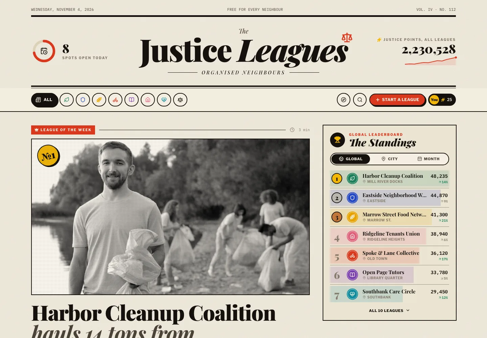

## What it is

- **Citywide leagues, neighbourhood chapters.** Climate, safety, food, transit, learning, housing, health, rights.
- **Real shifts, real capacity.** Join a league, claim a shift, survive a refresh. Two accounts see the same filled spots.
- **A steward desk, not a form.** Stewards post shifts, cancel them, and record attendance. Hours become points.
- **Server-authored Justice Points.** Append-only ledger. Joining awards +25 once; signup mints nothing; check-in awards hours × 12.

> Points land when a steward checks you in — not when you tap sign up. That distinction is the whole leaderboard.

## The paper in pictures

<table>
  <tr>
    <td width="50%"><a href="docs/screenshots/league.webp">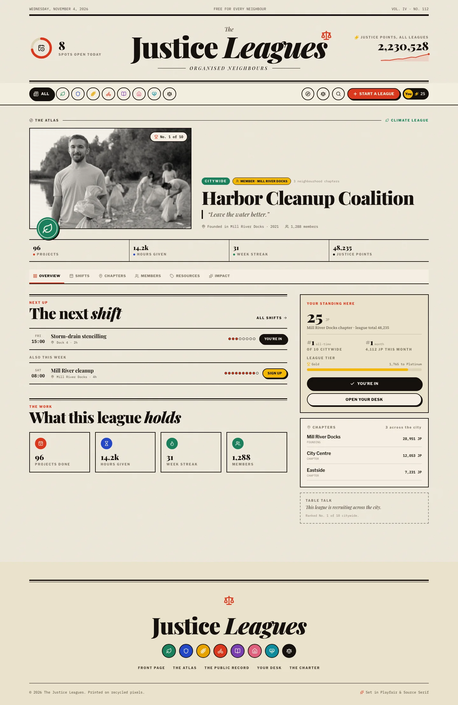</a><br/><sub><b>League page</b> · tabs, standing, and the next shift</sub></td>
    <td width="50%"><a href="docs/screenshots/steward.webp">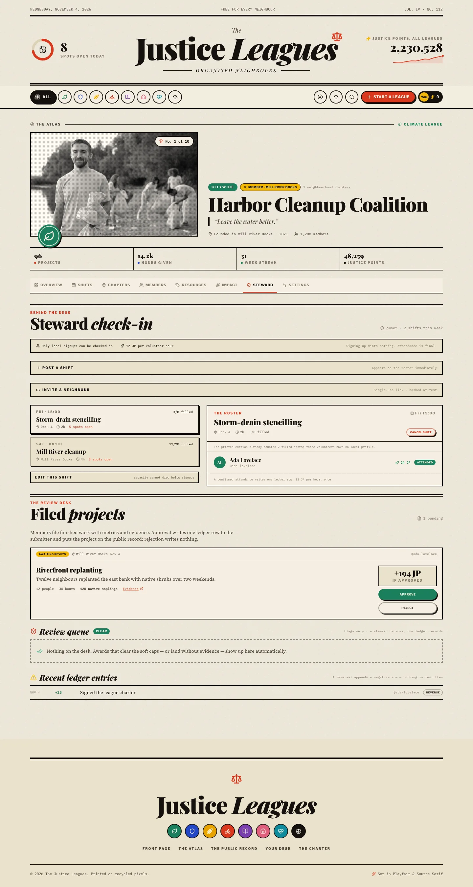</a><br/><sub><b>Steward desk</b> · post a shift, record hours, mint nothing by hand</sub></td>
  </tr>
  <tr>
    <td width="50%"><a href="docs/screenshots/chapters.webp">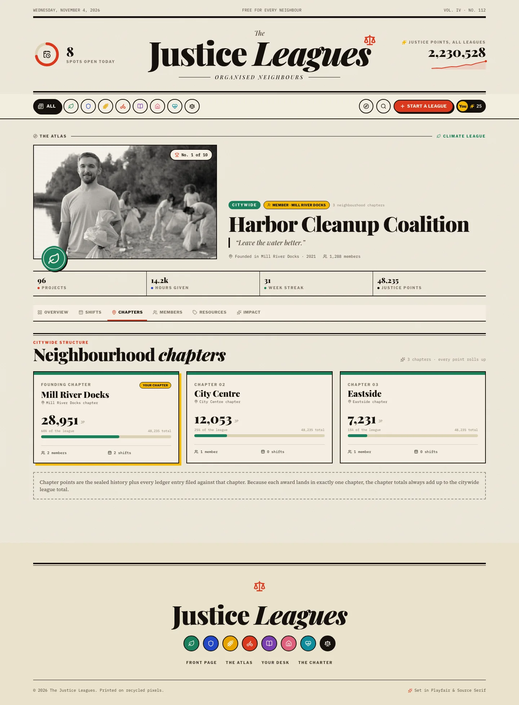</a><br/><sub><b>Chapters</b> · every point rolls up to the citywide league</sub></td>
    <td width="50%"><a href="docs/screenshots/dashboard.webp">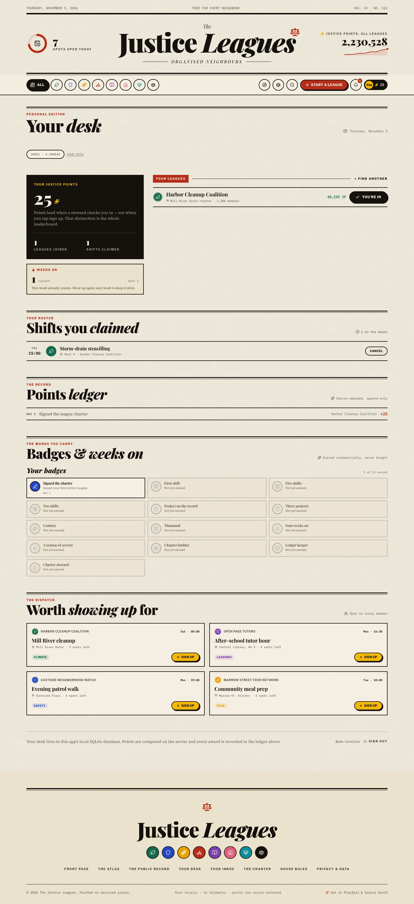</a><br/><sub><b>Your desk</b> · points, roster, and the ledger</sub></td>
  </tr>
  <tr>
    <td colspan="2"><a href="docs/screenshots/leagues.webp">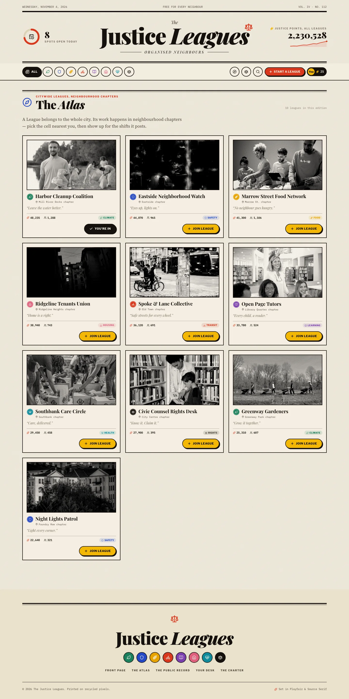</a><br/><sub><b>The Atlas</b> · every league, one editorial index</sub></td>
  </tr>
</table>

<table>
  <tr>
    <td width="33%"><a href="docs/screenshots/mobile-home.webp">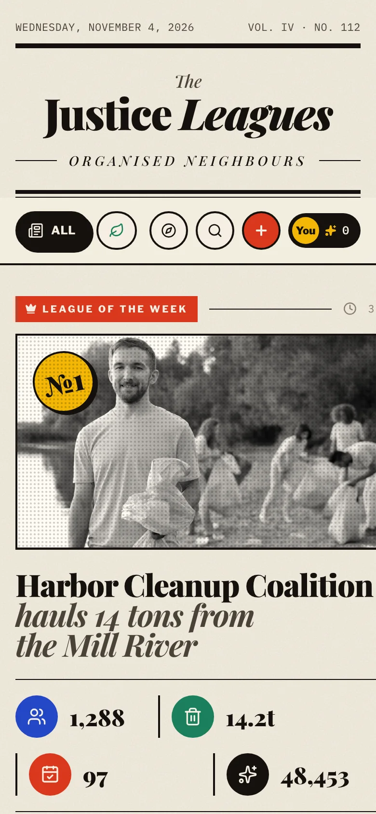</a></td>
    <td width="33%"><a href="docs/screenshots/mobile-league.webp">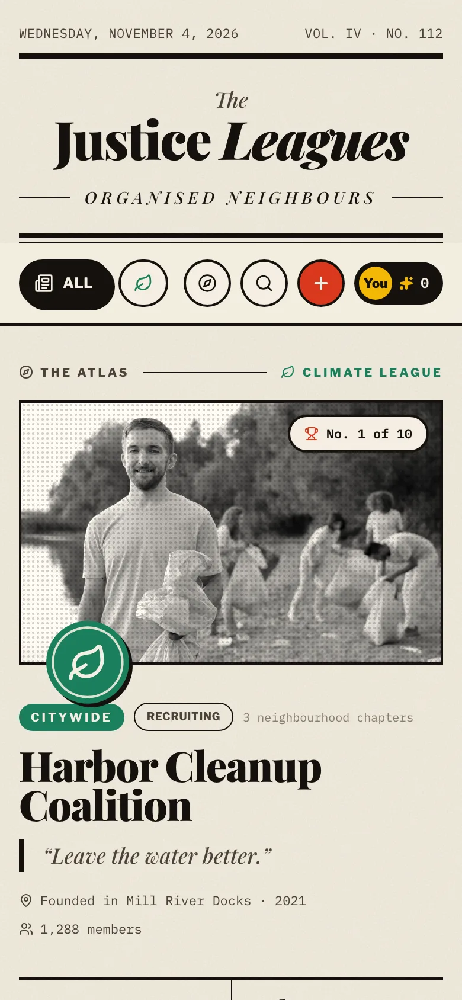</a></td>
    <td width="33%"><a href="docs/screenshots/mobile-dashboard.webp">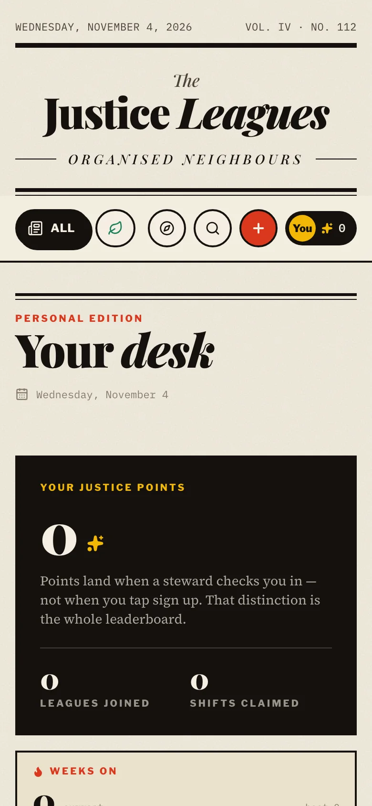</a></td>
  </tr>
  <tr>
    <td align="center"><sub>Front page</sub></td>
    <td align="center"><sub>League</sub></td>
    <td align="center"><sub>Your desk</sub></td>
  </tr>
</table>

## Under the hood

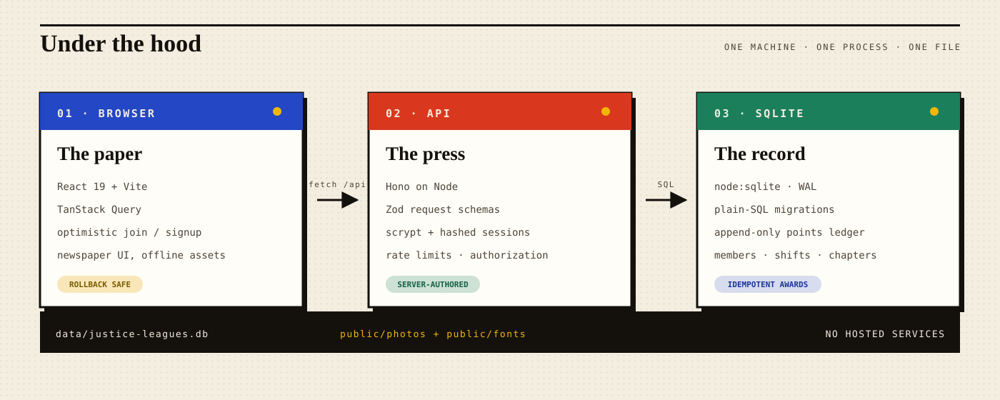

| Layer  | Choice                                                           |
| ------ | ---------------------------------------------------------------- |
| UI     | React 19 · Vite · Tailwind 4 · TanStack Query                    |
| API    | Hono on Node · Zod · scrypt · hashed session cookies             |
| Data   | `node:sqlite` · plain-SQL migrations · append-only points ledger |
| Assets | Photography and fonts vendored into `public/` — fully offline    |

## Run it

```bash
npm install
npm run dev        # web :5173 · api :8787
```

Production-ish, one origin:

```bash
npm run build
npm start          # dist/ + /api on :8787
```

Local data lives in `data/justice-leagues.db`.

```bash
npm run db:seed    # migrate + seed if empty
npm run db:reset   # throw the paper away and rebuild it
```

### Demo stewards

A fresh seed gives every chapter a steward. The founding chapter's steward owns the league. They all use the password `millbrook`:

```text
steward.harbor.1@justiceleagues.local   # owner, Mill River Docks
steward.harbor.2@justiceleagues.local   # steward, City Centre
steward.harbor.3@justiceleagues.local   # steward, Eastside
```

Swap `harbor` for any league id (`spoke`, `ridgeline`, `civic`, …) and `1`–`3` for a chapter. These are local demo accounts — nothing leaves the machine.

## Checks

```bash
npm run typecheck
npm run lint
npm run test       # 32 unit + API integration tests
npm run test:e2e   # 8 Playwright tests, isolated :8788 / :5174 / data/e2e.db
npm run shots      # design-review screenshots → /tmp/jl-shots
```

## House rules

- **No hosted services.** No Supabase, no cloud sync, no telemetry.
- **Points are data, not decoration.** Every award is a ledger row with an idempotency key.
- **Editorial first.** Read [`DESIGN.md`](DESIGN.md) before touching the UI.
- **Commit small, push often.** See [`AGENTS.md`](AGENTS.md).

<div align="center">
  <sub>Photography from <a href="https://www.pexels.com/license/">Pexels</a> · typefaces via <a href="https://fonts.google.com/">Google Fonts</a> (OFL) · built with too much coffee.</sub>
</div>
